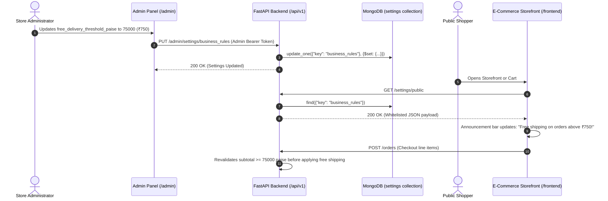

# BIGCHAMP — Admin-Driven Dynamic Storefront Configuration Matrix

## 1. Overview & Principle of Dynamic Control

In Phase 6.1, all hardcoded business values, marketing claims, fee amounts, discount percentages, and policy thresholds previously embedded across React frontend components were eliminated and mapped to MongoDB-backed dynamic configuration models.

The administrator configures these values through the authorized **Admin Panel** (`admin/src/pages/SettingsPage.jsx` and `admin/src/pages/BannersPage.jsx`), which persists to the `settings` and `banners` collections via `PUT /admin/settings/{key}`.

The backend exposes a whitelisted subset of safe configuration fields publicly at `GET /settings/public`, ensuring that:
1. **No frontend source code rebuild** is required to update fees, limits, or announcements.
2. **Backend authority is strictly preserved**: Critical financial calculations (subtotals, shipping thresholds, taxes, coupon eligibility, and payment verification) remain calculated and validated server-side.

---

## 2. Dynamic Configuration Field Mapping Matrix

| Configuration Category | Field Name | MongoDB Setting Key | Backend Admin Endpoint | Admin Panel Control UI | Public Storefront Endpoint | Frontend Consumer & Display Impact |
| :--- | :--- | :--- | :--- | :--- | :--- | :--- |
| **Membership & Pass** | `card_fee_paise` | `business_rules` | `PUT /admin/settings/business_rules` | `SettingsPage.jsx` $\rightarrow$ Business Rules | `GET /settings/public` | `StorefrontHeader`, `HomePage`, `MembershipPage`, `ProductDetailPage`, `DashboardLayout` |
| **Membership & Pass** | `card_validity_days` | `business_rules` | `PUT /admin/settings/business_rules` | `SettingsPage.jsx` $\rightarrow$ Business Rules | `GET /settings/public` | `HomePage` (Annual Pass perks), `MembershipPage` (Validity duration display) |
| **Cashback & Wallet** | `joining_cashback_percent` | `business_rules` | `PUT /admin/settings/business_rules` | `SettingsPage.jsx` $\rightarrow$ Business Rules | `GET /settings/public` | `HomePage` Hero trust badge & Member Perks strip |
| **Cookey Token** | `cookey_price_paise` | `business_rules` | `PUT /admin/settings/business_rules` | `SettingsPage.jsx` $\rightarrow$ Business Rules | `GET /settings/public` | `CookeyPage`, `HomePage` Cookey vertical banner |
| **Cookey Token** | `cookey_cooldown_days` | `business_rules` | `PUT /admin/settings/business_rules` | `SettingsPage.jsx` $\rightarrow$ Business Rules | `GET /settings/public` | `CookeyPage` cycle duration rules |
| **Cookey Token** | `cookey_max_per_week` | `business_rules` | `PUT /admin/settings/business_rules` | `SettingsPage.jsx` $\rightarrow$ Business Rules | `GET /settings/public` | `CookeyPage` weekly purchase limit |
| **Defense Privilege** | `army_extra_discount_percent`| `business_rules` | `PUT /admin/settings/business_rules` | `SettingsPage.jsx` $\rightarrow$ Business Rules | `GET /settings/public` | `ArmyOfferPage`, `HomePage` Defense Personnel Card |
| **Shipping & Logistics** | `free_delivery_threshold_paise` | `business_rules` | `PUT /admin/settings/business_rules` | `SettingsPage.jsx` $\rightarrow$ Business Rules | `GET /settings/public` | `StorefrontHeader` Announcement Strip, `CartPage`, `ShippingPolicyPage` |
| **Shipping & Logistics** | `standard_delivery_charge_paise` | `business_rules` | `PUT /admin/settings/business_rules` | `SettingsPage.jsx` $\rightarrow$ Business Rules | `GET /settings/public` | `CartPage`, `CheckoutPage` subtotal estimation |
| **Store Discounts** | `default_member_discount_percent` | `business_rules` | `PUT /admin/settings/business_rules` | `SettingsPage.jsx` $\rightarrow$ Business Rules | `GET /settings/public` | `ProductCard`, `ProductDetailPage`, `StorefrontHeader` |
| **Tax & GST** | `tax_percent` | `business_rules` | `PUT /admin/settings/business_rules` | `SettingsPage.jsx` $\rightarrow$ Business Rules | `GET /settings/public` | `CartPage`, `CheckoutPage` breakdown |
| **Site Contact** | `phone`, `email`, `address` | `site_contact` | `PUT /admin/settings/site_contact` | `SettingsPage.jsx` $\rightarrow$ Site Contact Tab | `GET /settings/public` | `StorefrontFooter`, `ContactPage` |
| **Social Media** | `instagram`, `facebook`, `twitter` | `social_links` | `PUT /admin/settings/social_links` | `SettingsPage.jsx` $\rightarrow$ Social Links Tab | `GET /settings/public` | `StorefrontFooter` icon links |
| **Marketing Banners** | Banners list (`title`, `image_url`, `link`, `position`, `active`) | `banners` collection | `POST/PUT/DELETE /banners/{id}` | `BannersPage.jsx` CRUD table | `GET /banners?position=homepage_top` | `HomePage` dynamic promotional slot |
| **Product Catalog** | Products list & details | `products` collection | `POST/PUT/DELETE /products/{id}` | `ProductsPage.jsx` Catalog Table | `GET /products`, `GET /products/{slug}` | `StorePage`, `ProductDetailPage`, `HomePage` |
| **Categories** | Category taxonomy (`name`, `slug`, `order`, `active`) | `categories` collection | `POST/PUT/DELETE /categories/{id}` | `ProductsPage.jsx` $\rightarrow$ Category Modal | `GET /categories` | `StorePage` filter bar, `HomePage` Category grid |
| **Coupons & Offers** | Codes, discount types, validity, max uses | `coupons` collection | `POST/PUT/DELETE /coupons` | `OffersCouponsPage.jsx` | `POST /coupons/validate` | `CartPage`, `CheckoutPage` coupon application |

---

## 3. Dynamic Setting Propagation Flow

---

## 4. Operational Guardrails & Audit Safety

1. **Whitelisted Public Exposure:** Only safe business parameters are returned by `GET /settings/public`. Internal routing secrets, Razorpay private keys, database connection strings, and admin audit logs are strictly filtered.
2. **Audit Logging:** Every administrative update to `settings` triggers an audit event via `admin_audit.py` recording the changing admin ID, previous value, new value, and UTC timestamp.
3. **Graceful Fallbacks:** If the MongoDB settings collection is empty or a network error occurs, `settingsStore.js` immediately falls back to safe platform defaults so the storefront remains fully functional without visual breakage.
