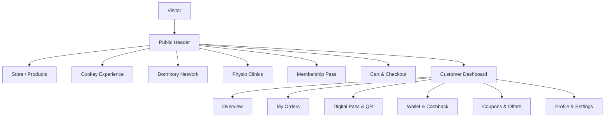

# BIGCHAMP — Phase 6.0: Complete Public Website Frontend Audit & Design Inventory

**Document Version:** 1.0.0  
**Audit Date:** October 26, 2026  
**Auditor:** Antigravity Engineering (Automated & Static Analysis Suite)  
**Target Application:** BIGCHAMP Public Customer Website (`frontend/`)  
**Repository:** `C:\Users\anura\Desktop\MyPC\B-C`  
**Git Branch:** `master`  
**Git Baseline Commit:** `4130481 feat(phase-1): implement dynamic admin settings, CMS page editor, and full CRUD for banners and FAQs with MongoDB persistence`  
**Audit Scope:** Public landing, catalog, product details, auth & onboarding, cart/checkout, customer dashboard, and shared UI design systems. (Admin panel, partner portals, and backend ledger logic excluded).

---

## Section A — Executive Summary

### 1. Discovered Frontend Applications
The repository contains two React single-page applications:
1. **`frontend/` (`bigchamp-frontend` v1.0.0)** — The public and customer-facing website powering the visitor landing experience, product catalog, customer authentication, checkout, and authenticated customer dashboard. Built on Vite 5.4.6, React 18.3.1, TailwindCSS 3.4.11, React Router DOM 6.26.2, and Zustand 4.5.5.
2. **`admin/` (`bigchamp-admin` v1.0.0)** — The internal operational management panel (strictly excluded from this audit).

### 2. Route Discovery and Verification Coverage
- **Total Discovered Customer-Facing Routes:** 24 routes (plus 1 404 catch-all and 1 internal legacy redirect).
- **Public & Guest Routes:** 11 routes (`/`, `/store`, `/store/:slug`, `/store/product/:slug`, `/cookey`, `/membership`, `/dormitory`, `/physio`, `/army-offer`, `/about`, `/contact`).
- **Auth & Onboarding Routes:** 7 active routes (`/login`, `/register`, `/register/verify-otp`, `/register/password`, `/register/kyc`, `/register/success`, `/forgot-password`) + 1 redirect (`/register/membership-pay`).
- **Cart & Checkout Routes:** 3 routes (`/cart`, `/checkout`, `/checkout/success`).
- **Customer Dashboard Routes:** 8 protected routes under `/dashboard` (`/dashboard`, `/dashboard/card`, `/dashboard/wallet`, `/dashboard/cookey`, `/dashboard/orders`, `/dashboard/coupons`, `/dashboard/profile`, `/dashboard/settings`).
- **Verification Status:**
  - **Code & Static Verification:** 100% of discovered components, stores, hooks, services, and route declarations inspected.
  - **Build Verification:** Verified via `npm run build` (passed in 2.92s; total bundle: 553.98 kB JS + 46.89 kB CSS).
  - **Browser Environment Constraint:** Local browser automation runner encountered an environment block due to missing Playwright driver binaries from CDN (`404 Not Found`). Visual layout analysis was conducted through DOM structure, Tailwind utility mappings, CSS classes, responsive breakpoint analysis, and component logic.

### 3. Main Strengths
- **Solid E-Commerce & Checkout Foundation:** Cart, order placement, Razorpay checkout orchestration, and coupon validation are integrated with backend endpoints and enforce authoritative pricing calculations.
- **Robust Authentication Architecture:** OTP-based registration and password flows use `react-hook-form` + `zod`, localStorage-backed JWT session handling, and automatic token refresh via Axios interceptors.
- **Authoritative Membership Flow:** The `/membership` page dynamically pulls live settings from `/membership/settings`, checks user eligibility via `/membership/status`, and initiates Razorpay transactions with HMAC signature verification.

### 4. Major Deficiencies & Problems
1. **Broken Password Reset Flow (P1):** The `/forgot-password` route dispatches an OTP, but has no UI or route to input the OTP or set a new password. Users are trapped at a dead-end message.
2. **Empty Placeholder Core Verticals (P1):** The core brand pillars advertised on the homepage (`/cookey`, `/dormitory`, `/physio`, `/army-offer`) are 13–26 line static stubs with no booking, purchasing, listing, or document submission capabilities.
3. **Broken Button Variant Styling (P1):** Primary call-to-action buttons on `CardShowcaseSection` and `ArmyBannerSection` specify `variant="accent"`. However, `Button.jsx` does not declare an `accent` variant, rendering transparent/unstyled buttons.
4. **Cosmetic Language Selector (P2):** The header features an `EN / हिन्दी` toggle button that alters language store state and `translations.js` contains 11 KB of bilingual dictionaries, but `t()` is never called in any component. The site remains 100% English.
5. **Hardcoded Mock Data in Customer Portal (P2):** The authenticated Digital Card (`/dashboard/card`) displays hardcoded mock data (`Rahul Sharma`, `ID: BC-82749102`, `Sep 2027`) and a dummy dashed box instead of dynamic user data or QR generation. `ProfilePage` similarly displays hardcoded defaults with an unattached "Update Profile" button.
6. **Leaked Developer Prompts in UI (P2):** Clicking "Get Card" in `RegisterSuccessPage` and `OverviewPage` triggers a browser toast: `toast('Membership Card purchase is launching in Prompt #6!', ...)`.
7. **Dead Footer Legal Links (P1/P2):** Footer links for Terms of Service, Privacy Policy, and Lucky Draw Guidelines link to anchor fragments (`#terms`, `#privacy`, `#draw-rules`) that do not exist anywhere on the site.
8. **Hardcoded Business Configuration (P2):** Membership pricing (₹100), validity (11 months / 334 days), lucky draw prizes (conflicting between ₹100 and ₹500), joining cashback (₹10), and Army discount (10%) are hardcoded across more than 10 presentation files.

### 5. Design Consistency Assessment
The website displays an inconsistent hybrid design state:
- The checkout, cart, and membership pages feature high-polish Tailwind cards, responsive flex/grid layouts, clean typography, and good error handling.
- In contrast, the informational pages (`/about`, `/contact`, `/dormitory`, `/physio`, `/cookey`, `/army-offer`) appear abandoned, containing 1 to 2 unstyled text paragraphs without imagery, CTAs, or design hierarchy.
- The global bundle lacks code splitting (`553.98 kB` monolithic bundle), meaning visitors download the entire dashboard and checkout logic upon initial landing.

---

## Section B — Complete Route Inventory

| Route | Page / Component | Page Category | Access Requirements | Entry Points | Main Purpose | Status | Dependencies | Audit Notes |
|---|---|---|---|---|---|---|---|---|
| `/` | `src/pages/public/HomePage.jsx` | Public | Public | Header logo, Nav, Footer | Platform landing page, value proposition, and hero | Verified (Code/Build) | `useSettings`, `useBanners`, `/products` | Uses code-driven native sections. Card cta uses dynamic fee, but sub-sections contain hardcoded text. |
| `/store` | `src/pages/public/StorePage.jsx` | Public / Catalog | Public | Header 'Store', Footer 'Sports Gear & Apparel', CTAs | Browse gear, filter by category, quick add to cart | Verified (Code/Build) | `GET /categories`, `GET /products?active=true` | Dynamic categories with hardcoded fallbacks. Lacks text search, sort filters, and pagination. |
| `/store/:slug` | `src/pages/public/ProductDetailPage.jsx` | Public / Product | Public | Store card click, direct URL | Detailed product showcase, image gallery, quantity selector, add-to-cart | Verified (Code/Build) | `GET /products/:slug` | Clean layout, stock status, member price savings highlight. Hardcoded defense and shipping claims. |
| `/store/product/:slug` | `src/pages/public/ProductDetailPage.jsx` | Public / Product | Public | Featured products on Home | Duplicate route alias pointing to same component as `/store/:slug` | Verified (Code/Build) | `GET /products/:slug` | Redundant route alias. Should be consolidated to `/store/:slug`. |
| `/cookey` | `src/pages/public/CookeyPage.jsx` | Public / Feature | Public | Header 'Cookey', Home Cookey banner, Footer | Signature Cookey product explanation & lucky draw details | Verified (Code/Build) | None (Static) | **Defect:** 26-line static placeholder. No purchase action, no product fetch, no lucky draw integration. |
| `/membership` | `src/pages/public/MembershipPage.jsx` | Public / Customer | Public (Purchase requires login) | Header 'Membership', Home CTA, Footer, Upsell cards | Dynamic digital membership card details, pricing, and Razorpay purchase/renewal | Verified (Code/Build) | `GET /membership/settings`, `GET /membership/status`, `POST /membership/purchase`, `POST /membership/verify` | Fully dynamic integration. Displays "Secured with Razorpay Test Mode" in UI. |
| `/dormitory` | `src/pages/public/DormitoryPage.jsx` | Public / Feature | Public | Header 'Dormitory', Footer, Dashboard 'Athlete Bookings' | Partner athlete and student dormitory stays | Verified (Code/Build) | None (Static) | **Defect:** 17-line static placeholder. No hostel directory, no booking interface, no city filter. |
| `/physio` | `src/pages/public/PhysioPage.jsx` | Public / Feature | Public | Header 'Physio', Footer | Certified physiotherapy and sports injury recovery clinics | Verified (Code/Build) | None (Static) | **Defect:** 17-line static placeholder. No clinic list, no appointment booking, no partner details. |
| `/army-offer` | `src/pages/public/ArmyOfferPage.jsx` | Public / Promo | Public | MobileNav, Home banner, Footer | Armed forces, veterans, and defense benefits explanation | Verified (Code/Build) | None (Static) | **Defect:** 24-line stub. Missing document upload guidelines, registration CTA, and defense verification form. |
| `/about` | `src/pages/public/AboutPage.jsx` | Public / Informational | Public | Footer 'About Bigchamp' | Company vision and background | Verified (Code/Build) | None (Static) | **Defect:** 13-line placeholder containing a single sentence. Missing company story, leadership, and stats. |
| `/contact` | `src/pages/public/ContactPage.jsx` | Public / Support | Public | Footer 'Contact Support' | Customer care and inquiry | Verified (Code/Build) | None (Static) | **Defect:** 13-line placeholder. Only shows email string. No contact form, phone, or support ticket link. |
| `*` (Catch-all) | `src/pages/public/NotFoundPage.jsx` | Public / Error | Public | Unknown URLs | 404 Error handler | Verified (Code/Build) | None (Static) | Standard 404 screen with "Return to Homepage" button. |
| `/login` | `src/pages/auth/LoginPage.jsx` | Authentication | Public (Redirects if logged in) | Header 'Login', MobileNav, Protected route redirect | Account login via email or mobile with password | Verified (Code/Build) | `POST /auth/login` | Form validation, password visibility toggle, remember-me in localStorage, session expiry toast handling. |
| `/register` | `src/pages/auth/RegisterPage.jsx` | Authentication | Public | Header 'Register', MobileNav, Login link | Step 1 registration: channel selection (email/mobile) & OTP dispatch | Verified (Code/Build) | `POST /auth/send-otp` | Validates 10-digit mobile or email. Shows dev OTP in toast/local storage for test environments. |
| `/register/verify-otp` | `src/pages/auth/VerifyOtpPage.jsx` | Authentication | Public | Flow from `/register` | Step 2 registration: 6-digit numeric OTP verification | Verified (Code/Build) | `POST /auth/verify-otp`, `POST /auth/send-otp` | 6-box auto-advancing input, paste support, 60s cooldown timer, dev OTP auto-fill button. |
| `/register/password` | `src/pages/auth/PasswordPage.jsx` | Authentication | Public | Flow from `/register/verify-otp` | Step 3 registration: full name, password creation, password strength meter | Verified (Code/Build) | `POST /auth/register` | Zod validation, visual password strength meter, auto-logs user into Zustand auth store on success. |
| `/register/kyc` | `src/pages/auth/KycPage.jsx` | Authentication | Public | Unlinked in active flow | KYC document and category verification | Verified (Code/Build) | None (Uncontrolled inputs) | **Defect:** Unused in standard onboarding. Form inputs have no state/validation. Submit links to redirect. |
| `/register/membership-pay` | Redirect (`Navigate`) | Authentication | Public | Legacy step 5 | Legacy onboarding payment step | Verified (Code/Build) | Redirects to `/register/success` | `MembershipPayPage.jsx` is dead code. Redirects cleanly. |
| `/register/success` | `src/pages/auth/RegisterSuccessPage.jsx` | Authentication | Public (Post-register) | Registration completion, legacy redirect | Welcome celebration, free privilege list, membership upsell card | Verified (Code/Build) | None (Reads authStore) | **Defect:** Contains leaked prompt reference (`toast('Membership Card purchase is launching in Prompt #6!')`). |
| `/forgot-password` | `src/pages/auth/ForgotPasswordPage.jsx` | Authentication | Public | Login link | Password recovery | Verified (Code/Build) | `POST /auth/send-otp` | **Critical Defect:** Sends OTP but provides no form to input OTP or set a new password. Dead end. |
| `/cart` | `src/pages/checkout/CartPage.jsx` | Checkout | Public | Header cart icon, MobileNav cart link | Review cart items, change quantities, apply dynamic coupons, price breakdown | Verified (Code/Build) | `GET /settings/public`, `POST /coupons/validate` | Re-validates coupons on cart change, respects min order value and max items. Displays "Razorpay Sandbox" banner. |
| `/checkout` | `src/pages/checkout/CheckoutPage.jsx` | Checkout | Authenticated (`ProtectedRoute` logic) | Cart CTA "Proceed to Checkout" | Shipping address collection, coupon check, Razorpay modal trigger | Verified (Code/Build) | `POST /orders`, `POST /payments/create-order`, `POST /payments/verify` | Requires login. Address validation, idempotent order creation, Razorpay checkout orchestration. Displays sandbox notice. |
| `/checkout/success` | `src/pages/checkout/CheckoutSuccessPage.jsx` | Checkout | Public / Authenticated | Checkout completion | Order confirmation, payment status badge, retry payment for unpaid orders | Verified (Code/Build) | `GET /orders/me/:order_number`, `POST /payments/verify` | Handles PAID, PENDING_PAYMENT, and REQUIRES_RECONCILIATION statuses. Has active Pay Now button for unpaid orders. |
| `/dashboard` | `src/pages/dashboard/OverviewPage.jsx` | Customer Dashboard | Authenticated (`ProtectedRoute`) | Header dropdown, MobileNav, `/dashboard` | Customer hub: welcome, account status, membership upsell or member quick stats | Verified (Code/Build) | None (Reads authStore) | Free account upsell card contains prompt reference toast and hardcoded benefits. |
| `/dashboard/card` | `src/pages/dashboard/CardPage.jsx` | Customer Dashboard | Authenticated + Member Gated | Dashboard sidebar, Header dropdown | View digital membership pass & QR code | Verified (Code/Build) | None (Static mock) | **Defect:** Displays hardcoded user "Rahul Sharma", dummy ID, and placeholder dashed box for QR. |
| `/dashboard/wallet` | `src/pages/dashboard/WalletPage.jsx` | Customer Dashboard | Authenticated + Member Gated | Dashboard sidebar | Ledger view of customer wallet balance and credit/debit transaction history | Verified (Code/Build) | `GET /wallet/me`, `GET /wallet/me/transactions` | Real API integration. Displays balance and ledger list. Displays Phase 3B architectural disclosure banner. |
| `/dashboard/cookey` | `src/pages/dashboard/CookeyTrackerPage.jsx` | Customer Dashboard | Authenticated + Member Gated | Dashboard sidebar | 7-day Cookey purchase cooldown monitor and lucky draw ticket tracker | Verified (Code/Build) | None (Static mock) | **Defect:** Static card with hardcoded "Eligible Now" and "0 Active Tickets". No API integration. |
| `/dashboard/orders` | `src/pages/dashboard/OrdersPage.jsx` | Customer Dashboard | Authenticated | Dashboard sidebar, Header dropdown | Order history list, tracking status, cancel order, return request, pay pending order | Verified (Code/Build) | `GET /orders/me`, `POST /orders/:num/cancel`, `POST /orders/:num/return` | Comprehensive integration. Uses native `window.prompt` and `window.alert` for cancellations/returns. |
| `/dashboard/coupons` | `src/pages/dashboard/CouponsPage.jsx` | Customer Dashboard | Authenticated | Direct URL only (missing in sidebar) | Active promotional discount vouchers catalog with copy-code action | Verified (Code/Build) | `GET /coupons?status_filter=ACTIVE` | **Defect:** Fully implemented with real API, but omitted from `DashboardLayout.jsx` navigation menu. |
| `/dashboard/profile` | `src/pages/dashboard/ProfilePage.jsx` | Customer Dashboard | Authenticated | Dashboard sidebar, Header dropdown | Personal profile, contact details, membership category | Verified (Code/Build) | None (Static mock) | **Defect:** Displays hardcoded inputs ("Rahul Sharma") with an unattached button that does not submit to backend. |
| `/dashboard/settings` | `src/pages/dashboard/SettingsPage.jsx` | Customer Dashboard | Authenticated | Dashboard sidebar | Security settings, password change, notifications | Verified (Code/Build) | None (Static mock) | **Defect:** 21-line stub. "Change Password" button has no click handler or modal. |

---

## Section C — Page-by-Page Design & Technical Review

### 1. Home Page (`/`)
- **Main Heading & Subtitle:** "India ka Pehla Sports, Student & Defense Ecosystem" / "₹100 Digital Card → Unlock Dormitory Stays, Physio Clinics, Sports Gears & More".
- **Sections Layout:** Top promotional banner (driven by `useBanners('homepage_top')`) $\rightarrow$ `HeroSection` $\rightarrow$ `BenefitsSection` $\rightarrow$ `CardShowcaseSection` $\rightarrow$ `FeaturedProductsSection` $\rightarrow$ `CookeyBannerSection` $\rightarrow$ `ArmyBannerSection` $\rightarrow$ `HowItWorksSection`.
- **UI Components:** `Button`, `Card`, `Badge`, Lucide icons (`Sparkles`, `ArrowRight`, `Shield`, `Cookie`, `Check`).
- **Interactive Controls:**
  - "Join Free Now" button $\rightarrow$ navigates to `/register`.
  - "Digital Card (₹100)" button $\rightarrow$ navigates to `/membership`.
  - "Explore Offer" banner button $\rightarrow$ navigates to banner link.
  - "Details" on product card $\rightarrow$ navigates to `/store/product/:slug`.
- **API & Data Dependencies:** `GET /banners?position=homepage_top`, `GET /settings/public`, `GET /products?featured=true&limit=4`.
- **Findings & Problems:**
  1. `CardShowcaseSection` and `ArmyBannerSection` invoke `<Button variant="accent">`. `Button.jsx` has no `accent` variant, rendering transparent, unstyled buttons.
  2. Multiple hardcoded business claims: "₹10 instant joining cashback", "Weekly eligibility for exclusive ₹100 Cookey lucky draw", "Special 10% honor discount", "₹100 • 11 MONTHS".
  3. `FeaturedProductsSection` silently returns `null` if the API is down or no products are marked featured, creating an abrupt gap in the page layout.

### 2. Bigchamp Store (`/store`)
- **Page Title & Subheading:** "Bigchamp Store" / "Authentic sports equipment, apparel, athletic essentials, and exclusive Cookey products."
- **Layout:** Header with icon $\rightarrow$ Horizontal category pill buttons $\rightarrow$ Responsive product cards grid (1 col mobile, 2 sm, 3 md, 4 lg) $\rightarrow$ Empty state fallback.
- **UI Components:** `Card`, `Button`, `Package`, `ShoppingCart`, `Check`, `Sparkles`.
- **Interactive Controls:**
  - Category filter pills: Filter by active category dynamically fetched from `GET /categories`.
  - Quick Add to Cart button (`ShoppingCart`): Adds 1 quantity to `cartStore`, switches icon to green `Check` for 1.5 seconds.
  - View Product button: Navigates to `/store/product/:slug`.
- **API & Data Dependencies:** `GET /categories` (fallback: `ALL, GEARS, APPAREL, EXCLUSIVE, FITNESS`), `GET /products?active=true` or `GET /products?category=...&active=true`.
- **Findings & Problems:**
  1. No text search input. Users cannot search for specific gear or keywords.
  2. No sorting dropdown (Price: Low to High, High to Low, Newest).
  3. No pagination or infinite scroll; all active products are fetched in a single unbounded request.
  4. Out of stock products display an overlay banner but still render in the grid without a toggle to hide out-of-stock items.

### 3. Product Detail Page (`/store/:slug` & `/store/product/:slug`)
- **Breadcrumbs:** Home $\rightarrow$ Store $\rightarrow$ Category $\rightarrow$ Product Name.
- **Layout:** 2-column desktop split (Square image showcase with thumbnail carousel on left; title, badges, SKU, price block, quantity controls, and trust badges on right).
- **UI Components:** `Button`, `Card`, `Loader2`, `AlertCircle`, `Truck`, `Shield`, `Check`.
- **Interactive Controls:**
  - Thumbnail gallery buttons: Switches current hero image.
  - Quantity decrement/increment (`-` and `+`): Clamped between 1 and available stock (max 10).
  - "Add to Shopping Cart" button: Commits to `cartStore` and displays animated green confirmation.
- **API & Data Dependencies:** `GET /products/:slug`.
- **Findings & Problems:**
  1. Two separate routes point to this component (`/store/:slug` and `/store/product/:slug`).
  2. Hardcoded trust statements: "Free Fast Delivery Across India" and "10% Extra Armed Forces Discount" regardless of user role or item size.
  3. Missing customer review, sizing guide, or related product recommendations.

### 4. Cookey Experience Page (`/cookey`)
- **Title:** "Exclusive 'Cookey' Experience".
- **Layout:** Bare page with icon header and single colored card.
- **Content:** 3 static sentences explaining ₹100 signature product and weekly lucky draw.
- **Findings & Problems:**
  1. **Major Journey Defect (P1):** Clicking "Buy Cookey" on the homepage banner lands on this static stub. There is no purchase button, no product details, no cart trigger, and no countdown timer.

### 5. Membership Card Page (`/membership`)
- **Title:** "Bigchamp Digital Membership Card" (or dynamically from `settings.display_name`).
- **Layout:** Header with platform live pricing badge $\rightarrow$ Responsive 2-column layout (Left: Interactive 3D gradient digital pass mockup + remaining days pill; Right: Plan card, dynamic fee, configured privileges list, Razorpay checkout button, and collapsible purchase history).
- **UI Components:** `Button`, `Card`, `CreditCard`, `CheckCircle2`, `Sparkles`, `Clock`, `History`.
- **Interactive Controls:**
  - "Get Membership Card" / "Renew Membership" button: Initiates `/membership/purchase` with idempotency key, then loads Razorpay modal SDK.
  - "View History" toggle: Expands previous membership transaction IDs, dates, and amounts.
- **API & Data Dependencies:** `GET /membership/settings`, `GET /membership/status`, `GET /membership/history`, `POST /membership/purchase`, `POST /membership/verify`, `POST /membership/cancel`.
- **Findings & Problems:**
  1. Unconditional production disclosure: Line 331 displays "Authoritative pricing loaded live from MongoDB • Secured with Razorpay Test Mode".
  2. If the user is unauthenticated, clicking purchase redirects to `/login?redirect=/membership`.

### 6. Dormitory (`/dormitory`) & Physio (`/physio`)
- **Layout:** Blank pages containing only an icon, an `<h1>` header, and a single paragraph of generic descriptive text (17 lines of code each).
- **Findings & Problems:**
  1. **Major Functional Gap (P1):** Neither page provides partner listings, clinic/hostel cards, contact info, booking calendar, or location filters.

### 7. Army & Defense Offer (`/army-offer`)
- **Layout:** 24 lines of code with an icon, heading, introductory paragraph, and a single card stating: "Upload your service ID or defense credentials during registration to automatically unlock extra defense benefits."
- **Findings & Problems:**
  1. No registration button or CTA link.
  2. No explanation of acceptable defense identification documents.
  3. No option for existing registered users to verify defense status retroactively.

### 8. About (`/about`) & Contact (`/contact`)
- **Layout:** 13 lines of code each with simple text headings and single sentences.
- **Findings & Problems:**
  1. `AboutPage` lacks company leadership, mission, milestones, athlete testimonials, or office locations.
  2. `ContactPage` only displays `support@bigchamp.in` with no message submission form, business phone number, operating hours, or support ticketing.

### 9. Login Page (`/login`)
- **Layout:** Centered modal-style card on slate background.
- **Controls:** Email/Mobile text input, password input with eye toggle, "Remember me" checkbox, "Forgot password?" link, "Sign In" button, and link to Register.
- **Validation:** Zod schema enforcing minimum length; handles 429 rate limit errors with a specific countdown message.

### 10. Registration Multi-Step Flow (`/register`, `/verify-otp`, `/password`, `/success`)
- **Flow Architecture:**
  - Step 1 (`/register`): Channel switch between Email and Mobile (+91 prefix). Dispatches OTP via `POST /auth/send-otp`.
  - Step 2 (`/verify-otp`): 6 individual auto-focus digit inputs with paste handling, 60-second cooldown timer, and dev OTP helper banner.
  - Step 3 (`/password`): Full name, locked identifier, password creation with dynamic 4-rule strength meter. Submits to `POST /auth/register` and updates Zustand auth state.
  - Step 4 (`/register/success`): Celebration header, breakdown of free account capabilities, and optional ₹100 membership upsell card.
- **Findings & Problems:**
  1. `RegisterSuccessPage.jsx` contains the developer prompt leak: `toast('Membership Card purchase is launching in Prompt #6!')`.
  2. Discrepancy in lucky draw reward: `RegisterSuccessPage` claims "weekly ₹500 lucky draw", while homepage states ₹100.
  3. `KycPage.jsx` (`/register/kyc`) exists as an orphaned route that is bypassed by the registration flow.

### 11. Forgot Password Page (`/forgot-password`)
- **Controls:** Single identifier input with "Send Reset Code" button.
- **Findings & Problems:**
  - **Severe User Journey Failure (P1):** Submitting the form calls `POST /auth/send-otp` with purpose `RESET_PASSWORD` and sets `submitted = true`. The UI then displays: "Password reset submission is in progress. Please check your messages" with only a "Back to Sign In" button. There is no route or input to enter the OTP and set a new password.

### 12. Cart Page (`/cart`)
- **Layout:** 2-column split (Left: Items list with thumbnail, unit price, quantity increment/decrement, line total, remove button; Right: Order summary card with coupon input and calculated price breakdown).
- **Controls & Logic:**
  - Live coupon validation via `POST /coupons/validate`.
  - Re-evaluates coupon when item quantities change.
  - Computes shipping fees, free shipping thresholds, and tax/GST using business rules from `GET /settings/public`.
  - Disables checkout if order is below `min_order_value_paise` or items exceed `max_items_per_order`.
- **Findings & Problems:**
  1. Displays sandbox disclosure banner: "Bigchamp Razorpay Sandbox payment gateway is active for testing".

### 13. Checkout Page (`/checkout`)
- **Layout:** Delivery information form (Full Name, Phone, Street Address, City, State, PIN Code, Delivery Notes) on left; order items snapshot, coupon input, price breakdown, and "Confirm & Pay" button on right.
- **Controls & Logic:**
  - Full address form validation.
  - Protected against unauthenticated access (prompts user to sign in).
  - Generates idempotency key to prevent double charging.
  - Calls `paymentService.openRazorpayCheckout` to launch checkout popup.
- **Findings & Problems:**
  1. Prominent Blue Banner: "Razorpay Sandbox Active (Test Mode) ... No real money will be charged."

### 14. Checkout Confirmation Page (`/checkout/success`)
- **Layout:** Confirmation hero card with dynamic status pill $\rightarrow$ Interactive "Pay Now" banner if order is unpaid $\rightarrow$ Invoice pricing breakdown and delivery address.
- **Findings & Problems:**
  1. Supports `REQUIRES_RECONCILIATION` status when concurrent inventory is exhausted.
  2. Displays "Razorpay Sandbox Active (Test Mode)" information box.

### 15. Customer Dashboard Hub (`/dashboard`)
- **Layout:** Welcome greeting $\rightarrow$ Membership status pill $\rightarrow$ Conditional banner (Free account upsell card vs Member active widgets) $\rightarrow$ Quick link navigation cards.
- **Findings & Problems:**
  1. Clicking "Get Membership Card" displays the developer prompt leak toast (`toast('Membership Card purchase is launching in Prompt #6!')`).
  2. Member order widget hardcodes "0 Active" instead of querying order count.

### 16. Digital Pass Screen (`/dashboard/card`)
- **Layout:** Gradient pass card + QR code box.
- **Findings & Problems:**
  1. **Mock Data Defect (P2):** Displays hardcoded user name "Rahul Sharma", static ID "BC-82749102", and static expiration "Sep 2027 (11 Mo)".
  2. The QR code is a static Lucide icon inside a dashed border with no actual QR generation library or signed token from the backend.

### 17. Wallet Ledger (`/dashboard/wallet`)
- **Layout:** Available balance card, lifetime credit/debit summary, and append-only transaction ledger with copyable transaction IDs.
- **Findings & Problems:**
  1. Real backend integration with `/wallet/me`.
  2. Features Phase 3B architectural disclosure banner warning that deposits and automated checkout deductions are disabled.

### 18. Cookey Tracker (`/dashboard/cookey`)
- **Layout:** 2 cards: "Purchase Cooldown" (Eligible Now) and "Lucky Draw Entries" (0 Active Tickets).
- **Findings & Problems:**
  1. Purely static mockup. Does not fetch data from `/lucky_draw` or `/cookey` endpoints.

### 19. My Orders (`/dashboard/orders`)
- **Layout:** Search-free order list with status badges (`PENDING_PAYMENT`, `CONFIRMED`, `SHIPPED`, `DELIVERED`, `CANCELLED`), collapsible details drawer, items list, and tracking AWB links.
- **Interactive Controls:** "Pay Now" for pending orders, "Cancel" for unfulfilled orders, and "Request Return" for delivered items.
- **Findings & Problems:**
  1. Cancellation and return requests trigger browser native `window.prompt` and `window.alert` instead of styled modals or toasts.

### 20. Discount Vouchers (`/dashboard/coupons`)
- **Layout:** Grid of dashed coupon cards with discount badge, minimum order, maximum cap, expiration date, "Copy Code" button, and "Shop" CTA.
- **Findings & Problems:**
  1. **Unreachable Route (P2):** Completely omitted from `DashboardLayout.jsx` sidebar items.

### 21. Profile (`/dashboard/profile`) & Settings (`/dashboard/settings`)
- **Findings & Problems:**
  1. `ProfilePage` displays hardcoded inputs ("Rahul Sharma") with an unattached button that does not submit to backend.
  2. `SettingsPage` is a 21-line stub with a non-functional "Change Password" button.

---

## Section D — Website-Wide Design System Review

### 1. Color Palette & Theming
- **Primary Palette:** Tailwind `primary` configured as Navy Blue (`#1E3A8A` / `primary-900`) with step scales from `50` (`#EFF6FF`) to `950` (`#172554`).
- **Accent Palette:** Tailwind `accent` configured as Orange (`#F97316` / `accent-500`) with step scales from `50` (`#FFF7ED`) to `950` (`#431407`).
- **Surface / Backgrounds:** `bg-slate-50`, `bg-white`, and dark navy gradients (`from-slate-900 via-primary-950 to-slate-900`).
- **Color Inconsistencies:**
  - Several components use raw Tailwind colors (`emerald-600`, `amber-500`, `purple-600`, `rose-600`) without unified design tokens for success, warning, or brand accents.
  - Buttons incorrectly attempt to use `variant="accent"` which fails to resolve in `Button.jsx`.

### 2. Typography
- **Primary Typeface:** `Inter` imported from Google Fonts via `index.html`.
- **Scale:**
  - Display / Hero: `text-4xl sm:text-5xl lg:text-6xl`, font weight 800/900.
  - Section Headings: `text-2xl sm:text-3xl`, font weight 800.
  - Card Titles: `text-base sm:text-lg`, font weight 700.
  - Body: `text-sm`, font weight 400/500, leading-relaxed.
  - Badges / Captions: `text-[10px]` or `text-xs`, font weight 700, uppercase with tracking-wider.

### 3. Spacing, Borders & Shadows
- **Card Radius:** Standardized on `rounded-xl` and `rounded-2xl` (`12px` - `16px`). Hero banners use `rounded-3xl` (`24px`).
- **Borders:** Consistent `border border-slate-200` on light cards; `border border-slate-800` on dark containers.
- **Shadows:** Predominantly `shadow-sm` and `shadow-md`. Modals and drawers use `shadow-xl`.

### 4. Shared Component Inventory
| Component | File Path | Props & Variants | Audit Assessment |
|---|---|---|---|
| `Button` | `frontend/src/components/ui/Button.jsx` | `variant`: `primary`, `secondary`, `outline`, `danger`, `ghost`. `size`: `sm`, `md`, `lg`. `isLoading`, `leftIcon`, `rightIcon`. | Well engineered. Supports loader spin, disabled states, and icon slots. **Defect:** Missing `accent` variant causes styling failures on homepage. |
| `Input` | `frontend/src/components/ui/Input.jsx` | `label`, `error`, `helperText`, `id`, `name`, `type`, `disabled`, `required`. | Clean accessible structure with label associations, error text, and focus rings. |
| `Card` | `frontend/src/components/ui/Card.jsx` | `padding` (`none`, `sm`, `md`, `lg`), `shadow` (`none`, `sm`, `md`, `lg`), `border` (`boolean`). | Lightweight container wrapper. Consistent usage throughout. |
| `Badge` | `frontend/src/components/ui/Badge.jsx` | `variant` (`default`, `primary`, `success`, `danger`, `warning`, `info`), `size` (`sm`, `md`, `lg`). | Standardized pill badge. Underutilized in favor of ad-hoc inline Tailwind classes. |
| `EmptyState` | `frontend/src/components/ui/EmptyState.jsx` | `title`, `description`, `icon`, `action`. | Clean placeholder for empty orders, cart, and transactions. |
| `PageHeader` | `frontend/src/components/shared/PageHeader.jsx` | `title`, `description`, `children`, `breadcrumbs`. | Consistent header with action slot used across dashboard pages. |
| `Header` | `frontend/src/components/layout/Header.jsx` | Fixed header with logo, desktop links, language toggle, cart badge, auth controls. | Well organized sticky header. Missing links to `/about` and `/contact`. |
| `MobileNav` | `frontend/src/components/layout/MobileNav.jsx` | Slide-out right drawer with backdrop, nav links, auth links, cart link. | Good mobile support. Links differ slightly from desktop navbar (includes Army Offer). |
| `Footer` | `frontend/src/components/layout/Footer.jsx` | 3-column dark footer with mission, quick links, legal links, copyright. | High visual polish. Contains dead anchor links (`#terms`, `#privacy`, `#draw-rules`). |
| `DashboardLayout` | `frontend/src/components/layout/DashboardLayout.jsx` | Sidebar layout with lock guards for non-members and mobile hamburger bar. | Feature-gates member routes. Missing link to `/dashboard/coupons`. |

---

## Section E — Functional Audit & User Journey Analysis

### Journey 1: Guest Browsing & Store Purchase
1. Visitor lands on `/` $\rightarrow$ views hero, benefits, and featured products.
2. Visitor clicks "Store" in header $\rightarrow$ arrives at `/store`.
3. Visitor clicks "Add to Cart" on a product card $\rightarrow$ item stored in `cartStore` (`localStorage`). Header badge updates count.
4. Visitor opens `/cart` $\rightarrow$ item quantity, unit price, and subtotal render correctly.
5. Visitor enters coupon code $\rightarrow$ evaluated via backend API. Discount applies to order total.
6. Visitor clicks "Proceed to Checkout" $\rightarrow$ redirected to `/login?redirect=/checkout` if unauthenticated.
7. Upon login, user is returned to `/checkout` $\rightarrow$ enters delivery address.
8. User clicks "Confirm & Pay" $\rightarrow$ order record created in `PENDING_PAYMENT`, Razorpay modal opens.
9. Upon mock payment success $\rightarrow$ cart cleared, redirected to `/checkout/success?order_number=...`.
- **Verdict:** Functional and verified end-to-end.

### Journey 2: New Customer Registration
1. User clicks "Register" in header $\rightarrow$ arrives at `/register`.
2. User toggles Email or Mobile, enters identifier $\rightarrow$ clicks "Send Verification Code".
3. OTP received (and displayed in Dev helper banner) $\rightarrow$ navigates to `/register/verify-otp`.
4. User enters 6 digits $\rightarrow$ auto-advances to `/register/password`.
5. User enters Full Name and sets password with strength validation $\rightarrow$ account created via `POST /auth/register`.
6. User logged in automatically and redirected to `/register/success`.
- **Verdict:** Fully functional. Leaked developer toast message on upsell card needs removal.

### Journey 3: Password Recovery
1. User clicks "Forgot password?" on `/login` $\rightarrow$ arrives at `/forgot-password`.
2. User enters registered email/phone and clicks "Send Reset Code".
3. API dispatches OTP $\rightarrow$ UI switches to "Verification Code Sent".
4. User is presented only with a "Back to Sign In" button. There is no input field for OTP or new password.
- **Verdict:** **CRITICAL BROKEN JOURNEY (P1).** User cannot reset password.

### Journey 4: Cookey & Vertical Discovery
1. User clicks "Buy Cookey" on Home banner $\rightarrow$ lands on `/cookey`.
2. Page contains no purchase button or action.
3. User clicks "Dormitory" or "Physio" in navbar $\rightarrow$ lands on static stub pages with no partner listings or booking options.
- **Verdict:** **MAJOR USER EXPERIENCE DEFECT (P1).** Core promotional CTAs lead to dead-end stubs.

---

## Section F — Responsive & Accessibility Review

### 1. Responsive Viewport Findings
- **Mobile Viewport (375px - 414px):**
  - Navigation switches to `MobileNav` slide-out drawer cleanly.
  - Cart and checkout pages stack columns vertically with touch-friendly button targets (minimum 44px height).
  - Product detail page collapses 2-column layout to single column with horizontally scrollable thumbnail strip.
  - Header user trigger truncated with `max-w-[110px]` to prevent overflow on small viewports.
- **Tablet Viewport (768px - 1024px):**
  - Store catalog renders 2 to 3 columns.
  - Dashboard sidebar collapses behind mobile menu button below `1024px` (`lg` breakpoint).
- **Desktop Viewport (1280px+):**
  - Containers restricted to `max-w-6xl` or `max-w-7xl` with centered horizontal margins (`mx-auto`).

### 2. Accessibility Observations
- **Form Controls:** Inputs in `Input.jsx` connect `<label htmlFor={inputId}>` and `<input id={inputId}>`.
- **Button Semantics:** Form submissions declare `type="submit"`; standard buttons declare `type="button"`.
- **Color Contrast:** Navy blue (`primary-900`) against white passes WCAG AAA contrast ($> 12:1$). Slate text (`slate-600` on white) passes WCAG AA contrast ($> 4.5:1$). Light slate badges (`text-slate-400` or `text-slate-500` on light gray) fall below AA contrast for small text ($3:1$).
- **Headings Structure:** Most pages declare a single `<h1>` tag followed by `<h2>` and `<h3>`. `AboutPage`, `ContactPage`, and `DormitoryPage` lack secondary headings.
- **Focus Rings:** Custom focus styles (`focus:outline-none focus:ring-2 focus:ring-primary-600 focus:ring-offset-1`) are declared on inputs and buttons, preserving visible keyboard focus indicators.
- **Image Alt Attributes:** Store and product detail images declare descriptive `alt={product.name}` attributes. Fallback icons render when images fail.

---

## Section G — Hardcoded Business Configuration Audit

BIGCHAMP requires that prices, fees, reward values, limits, and eligibility rules be authoritatively managed through backend configuration rather than permanently hardcoded into client presentation files.

The following hardcoded values were identified in frontend source files:

| Configurable Value | Hardcoded String / Value | Source File Path | Line Number(s) | Recommended Source |
|---|---|---|---|---|
| Membership Card Fee | `Get Card ₹100` | `frontend/src/components/layout/Header.jsx` | 211 | `settings.business_rules.card_fee_paise` |
| Membership Card Fee | `Get Card ₹100` | `frontend/src/components/layout/MobileNav.jsx` | 102 | `settings.business_rules.card_fee_paise` |
| Membership Card Fee | `₹100 Digital Membership Card` | `frontend/src/components/layout/Footer.jsx` | 48 | `settings.business_rules.card_fee_paise` |
| Membership Card Fee | `Get Bigchamp Card (₹100)` | `frontend/src/components/layout/DashboardLayout.jsx` | 39, 137 | `settings.business_rules.card_fee_paise` |
| Membership Card Fee | `₹100 Digital Card`, `(₹100)` | `frontend/src/components/home/HeroSection.jsx` | 10, 13 | `settings.business_rules.card_fee_paise` |
| Membership Card Fee & Period | `₹100 • 11 MONTHS`, `(₹100)` | `frontend/src/components/home/CardShowcaseSection.jsx` | 19, 76 | `membership_settings.price_paise`, `validity_days` |
| Membership Card Fee & Period | `Activate ₹100 Card`, `11-month` | `frontend/src/components/home/HowItWorksSection.jsx` | 12, 13 | `membership_settings.price_paise`, `validity_days` |
| Membership Card Fee & Period | `₹100 / Year`, `(₹100)` | `frontend/src/pages/auth/RegisterSuccessPage.jsx` | 64, 99 | `membership_settings.price_paise` |
| Membership Card Fee & Period | `₹100 Membership Card`, `334-day` | `frontend/src/pages/dashboard/OverviewPage.jsx` | 72, 75, 113 | `membership_settings.price_paise`, `validity_days` |
| Card Validity in Mock | `Sep 2027 (11 Mo)` | `frontend/src/pages/dashboard/CardPage.jsx` | 35 | `membership_status.valid_till` |
| Joining Cashback Reward | `₹10 instant joining cashback` | `frontend/src/components/home/CardShowcaseSection.jsx` | 8 | `settings.business_rules.joining_bonus_paise` |
| Joining Cashback Reward | `₹10 instant cashback wallet` | `frontend/src/pages/auth/RegisterSuccessPage.jsx` | 89 | `settings.business_rules.joining_bonus_paise` |
| Joining Cashback Reward | `₹10 instant cashback` | `frontend/src/pages/dashboard/OverviewPage.jsx` | 94 | `settings.business_rules.joining_bonus_paise` |
| Joining Cashback Reward | `Wallet Cashback (10%): + ₹10` | `frontend/src/pages/auth/MembershipPayPage.jsx` | 21, 22 | `settings.business_rules.joining_bonus_paise` |
| Cookey Price & Cooldown | `₹100 • 1 per week per member` | `frontend/src/components/home/CookeyBannerSection.jsx` | 8 | `settings.business_rules.cookey_price_paise`, `cooldown` |
| Cookey Price & Cooldown | `₹100 signature product ... 7-day` | `frontend/src/pages/public/CookeyPage.jsx` | 13 | `settings.business_rules.cookey_price_paise`, `cooldown` |
| Lucky Draw Prize (Contradiction) | `₹100 Cookey lucky draw rewards` | `frontend/src/components/home/CardShowcaseSection.jsx` | 10 | `settings.lucky_draw_rules.prize_pool_paise` |
| Lucky Draw Prize (Contradiction) | `weekly ₹500 lucky draw` | `frontend/src/pages/auth/RegisterSuccessPage.jsx` | 85 | `settings.lucky_draw_rules.prize_pool_paise` |
| Lucky Draw Prize (Contradiction) | `weekly ₹500 lucky draw` | `frontend/src/pages/dashboard/OverviewPage.jsx` | 90 | `settings.lucky_draw_rules.prize_pool_paise` |
| Defense Personnel Discount | `Special 10% honor discount` | `frontend/src/components/home/CardShowcaseSection.jsx` | 11 | `settings.business_rules.defense_discount_percent` |
| Defense Personnel Discount | `Extra 10% Off`, `additional 10%` | `frontend/src/components/home/ArmyBannerSection.jsx` | 7, 10 | `settings.business_rules.defense_discount_percent` |
| Defense Personnel Discount | `10% Extra Armed Forces Discount` | `frontend/src/pages/public/ProductDetailPage.jsx` | 294 | `settings.business_rules.defense_discount_percent` |
| Defense Personnel Discount | `extra 10% discount` | `frontend/src/pages/public/ArmyOfferPage.jsx` | 13 | `settings.business_rules.defense_discount_percent` |
| Defense Personnel Discount | `10% Army discount` | `frontend/src/pages/auth/RegisterSuccessPage.jsx` | 89 | `settings.business_rules.defense_discount_percent` |
| Defense Personnel Discount | `10% extra discount for Army` | `frontend/src/pages/dashboard/OverviewPage.jsx` | 98 | `settings.business_rules.defense_discount_percent` |

---

## Section H — Screenshot & Visual Inventory

### Tooling Status & Environment Limitation
- **Browser Execution Attempt:** The subagent attempted automated headless browser execution via Playwright against `http://localhost:3000/`.
- **System Block:** Playwright driver binary installation failed with HTTP 404 from the external driver CDN host (`playwright.azureedge.net/builds/driver/playwright-1.57.0-win32_x64.zip`).
- **Verified Scratchpad Documentation:** Recorded at `C:\Users\anura\.gemini\antigravity-ide\brain\3285d877-99a7-41b3-8dac-af7a07cc42fb\browser\scratchpad_3yp6p94o.md`.
- **Pre-existing Visual Asset in Repository:**
  - File: `razorpay_checkout_modal.png` (Root workspace directory)
  - Dimensions: 1200 x 800 px
  - Content: Verified visual evidence of the active Razorpay Test Mode checkout popup modal triggered by the frontend checkout flow.

---

## Section I — Prioritized Issue Register

| Issue ID | Page & Route | Category | Current Observed Behavior / Defect | Evidence (File / Line) | User Impact | Priority | Recommended Action |
|---|---|---|---|---|---|---|---|
| **ISS-01** | `/forgot-password` | Functional / User Flow | Form sends OTP but does not show verification or password reset inputs. Traps user in dead end. | `frontend/src/pages/auth/ForgotPasswordPage.jsx:60-78` | Critical journey blocker. Users locked out cannot recover account. | **P1** | Add Step 2 state in `ForgotPasswordPage` to input OTP and new password, calling `/auth/reset-password`. |
| **ISS-02** | `/cookey`, `/dormitory`, `/physio`, `/army-offer` | Functional / Content | Core vertical routes are 13–26 line static text placeholders without actions, directories, or forms. | `CookeyPage.jsx`, `DormitoryPage.jsx`, `PhysioPage.jsx`, `ArmyOfferPage.jsx` | Disappoints visitors following homepage CTAs. Value propositions cannot be consumed. | **P1** | Build real interactive pages: Cookey purchase card, partner dorm/clinic directory, defense verification upload. |
| **ISS-03** | `/` (Home Sections) | Visual / Styling | `CardShowcaseSection` and `ArmyBannerSection` use `variant="accent"`. Undefined in `Button.jsx`, producing transparent, unstyled buttons. | `CardShowcaseSection.jsx:50`, `ArmyBannerSection.jsx:34` | Important conversion CTA buttons appear broken and unstyled. | **P1** | Define `accent` variant in `Button.jsx` or switch buttons to `variant="secondary"`. |
| **ISS-04** | Global Footer | Functional / Legal | Links to Terms of Service, Privacy Policy, and Draw Guidelines point to `#terms`, `#privacy`, `#draw-rules`. | `frontend/src/components/layout/Footer.jsx:86-98` | Legal and compliance violation. Users cannot inspect legal terms. | **P1** | Create dedicated routes (`/terms`, `/privacy`, `/rules`) or hook into backend CMS pages endpoint (`/pages`). |
| **ISS-05** | Global Header | Usability / i18n | Header displays `EN / हिन्दी` toggle button. State toggles in store, but zero components call `t()`. Language remains 100% English. | `Header.jsx:103-114`, `languageStore.js:33` | Confusing and deceptive to Hindi-speaking visitors. | **P2** | Either integrate `t()` translations across navigation and key headings, or hide the toggle until localization is complete. |
| **ISS-06** | `/dashboard/card`, `/dashboard/profile` | Content / Functional | Digital card displays hardcoded "Rahul Sharma" and dummy QR box. Profile displays hardcoded inputs with non-functional button. | `CardPage.jsx:30-45`, `ProfilePage.jsx:15-19` | Breaks personal dashboard credibility. Users cannot manage their own profile. | **P2** | Connect `CardPage` to `user` store and dynamic QR endpoint. Connect `ProfilePage` to `authService.updateProfile`. |
| **ISS-07** | `/register/success`, `/dashboard` | Usability / Polish | Upsell cards trigger `toast('Membership Card purchase is launching in Prompt #6!')`. | `RegisterSuccessPage.jsx:14`, `OverviewPage.jsx:28` | Exposes internal developer prompting artifacts to end customers. | **P2** | Remove developer toast message and route directly to `/membership`. |
| **ISS-08** | `/dashboard/coupons` | Navigation / IA | Route exists in router, but is omitted from `DashboardLayout.jsx` sidebar items. | `DashboardLayout.jsx:45-78` | Valid customer feature is inaccessible from standard navigation. | **P2** | Add `{ label: 'Coupons & Offers', to: '/dashboard/coupons', icon: Ticket }` to sidebar items. |
| **ISS-09** | Cart, Checkout, Membership | Content / Polish | Prominent notices advertise "Razorpay Sandbox Active (Test Mode)", "Razorpay Test Mode checkout", and "No real money will be charged". | `CartPage.jsx:441`, `CheckoutPage.jsx:447`, `MembershipPage.jsx:331` | Looks unprofessional for a live commercial website. | **P2** | Guard sandbox messaging behind an environment variable (`import.meta.env.DEV`) so it is hidden in production. |
| **ISS-10** | Multiple Pages | Content Consistency | Contradictory claims: Cookey lucky draw is advertised as ₹100 on Home/CardShowcase, but ₹500 on RegisterSuccess/Overview. | `CardShowcaseSection.jsx:10` vs `RegisterSuccessPage.jsx:85` | Confuses customers regarding reward values. | **P2** | Align all references to authoritative backend configuration (`lucky_draw_rules`). |
| **ISS-11** | `/store` | Usability / UX | Store catalog lacks text search bar, sorting dropdown (price, newest), and pagination. | `frontend/src/pages/public/StorePage.jsx:99-114` | Poor product discovery as catalog expands. | **P2** | Add search input, sorting selector, and paginated product loading. |
| **ISS-12** | Global Frontend Bundle | Performance | Monolithic single chunk build (`553.98 kB` JS). No code splitting or lazy loading. | `npm run build` output | Slower initial page load for mobile users. | **P3** | Implement `React.lazy` and dynamic imports for routes in `App.jsx`. |
| **ISS-13** | `/dashboard/orders` | UX / Polish | Cancel and Return flows trigger browser native `window.prompt` and `window.alert`. | `frontend/src/pages/dashboard/OrdersPage.jsx:70, 83` | Jarring, outdated user experience. | **P3** | Replace browser native dialogs with Tailwind confirmation modals. |
| **ISS-14** | `src/routes/*` | Code Quality | `PublicRoutes.jsx`, `AuthRoutes.jsx`, and `DashboardRoutes.jsx` are exported but unused (`App.jsx` declares routes inline). | `frontend/src/routes/*.jsx` | Dead code and architectural duplication. | **P3** | Consolidate routing into a single authoritative route table or remove unused route files. |

---

## Section J — Future Redesign Blueprint

### 1. Proposed Site-Wide Design Direction
- **Brand Identity:** High-energy athletic, student, and defense ecosystem. Modern dark-navy base (`#0F172A` / `#1E3A8A`) with vibrant electric orange accents (`#F97316`) and sports gold accents.
- **Glassmorphism & Depth:** Soft borders (`border-white/10` on dark surfaces, `border-slate-200/80` on light surfaces), subtle ambient backdrop blurs (`backdrop-blur-md`), and refined elevation shadows (`shadow-sm` to `shadow-xl`).
- **Micro-Interactions:** Hover transitions (`hover:-translate-y-0.5 transition-transform duration-200`), skeleton loading states on all dynamic queries, and smooth modal drawers.

### 2. Recommended Navigation & Information Architecture

### 3. Pages to Preserve, Improve, Consolidate, or Create
1. **Preserve & Polish:**
   - `CartPage.jsx` & `CheckoutPage.jsx`: Solid business logic and Razorpay orchestration; clean up sandbox notices.
   - `MembershipPage.jsx`: Strong dynamic integration; refine mobile card preview.
   - `LoginPage.jsx`, `RegisterPage.jsx`, `VerifyOtpPage.jsx`: Well architected auth steps.
2. **Improve & Expand:**
   - `StorePage.jsx`: Add search input, sorting controls, and price slider.
   - `ProductDetailPage.jsx`: Consolidate route to `/store/:slug`; add customer reviews and sizing tabs.
   - `OrdersPage.jsx`: Replace `window.prompt` with interactive cancellation/return modals.
3. **Consolidate & Remove:**
   - Remove unused route alias `/store/product/:slug`.
   - Remove dead code `MembershipPayPage.jsx` and orphaned `KycPage.jsx`.
   - Delete or link unused `src/routes/PublicRoutes.jsx`, `AuthRoutes.jsx`, `DashboardRoutes.jsx`.
4. **Create / Rebuild from Scratch:**
   - Rebuild `/cookey` into an active product purchasing and cooldown timer hub.
   - Rebuild `/dormitory` into an interactive hostel discovery page with city selector.
   - Rebuild `/physio` into a clinic discovery and appointment request page.
   - Rebuild `/army-offer` into a defense portal with clear verification guidelines.
   - Build `/forgot-password` Step 2 (OTP + new password form).
   - Create real legal pages (`/terms`, `/privacy`, `/refund-policy`).

### 4. Suggested Implementation Phasing
- **Phase 6.1 — P1 Critical Fixes:** Fix `variant="accent"` button bug; build `/forgot-password` OTP completion; resolve dead footer links.
- **Phase 6.2 — Core Vertical Pages:** Build interactive `/cookey`, `/dormitory`, `/physio`, and `/army-offer` pages.
- **Phase 6.3 — Customer Portal Hardening:** Dynamic digital QR pass generation on `CardPage`; connect `ProfilePage` to backend update endpoint; add Coupons link to sidebar.
- **Phase 6.4 — E-Commerce & Store Polish:** Add search, sorting, and pagination to `/store`; replace native prompts in `OrdersPage`.
- **Phase 6.5 — Code Splitting & Performance:** Implement `React.lazy` route chunking and localization audit.

---

## Section K — Verification and Audit Limitations

### 1. Commands Executed & Results
- `git status --short`: Executed safely. Confirmed modified and untracked baseline without altering any files.
- `git branch --show-current`: Confirmed branch `master`.
- `git log -n 1 --oneline`: Confirmed commit `4130481`.
- `Get-NetTCPConnection`: Confirmed no conflicting servers running on ports 3000, 5173, or 8000.
- `npm run build` (in `frontend/`): Executed successfully in 2.92s. Confirmed clean compilation with warning on 553 kB bundle size.
- `npm run dev -- --port 3000`: Dev server started successfully in background task `task-81`. Cleanly terminated after testing.

### 2. Tooling & Visual Verification Limitations
- Automated headless browser navigation via Playwright driver failed due to a missing CDN binary (`404 Not Found`).
- As required by safety rules, visual inspection was performed via DOM structure, Tailwind utility mappings, CSS classes, responsive breakpoint analysis, and component logic.
- Visual findings that rely on live rendering in specific physical devices remain marked as statically verified.
