# BIGCHAMP Phase 7.0 — Forensic Baseline Audit

**Repository:** `C:\Users\anura\Desktop\MyPC\B-C`  
**Branch:** `master`  
**Execution Date:** October 26, 2026  
**Auditor:** Principal Full-Stack Engineer, Senior E-Commerce Architect & QA Lead  
**Scope:** Complete forensic inspection of storefront, admin panel, media subsystem, catalog database, API contracts, deployment containers, and test baseline.

---

## 1. Executive Summary & Verification State

The Phase 7.0 forensic baseline audit was conducted directly against the active repository and live Docker deployment (`bigchamp-app` container running on port 80/3000/3001/3002 and `bigchamp-mongodb` on port 27017).

### Key Baseline Verified Facts:
1. **Container & Network Status:**
   - Docker container `bigchamp-app` is healthy and active.
   - Nginx reverse-proxies:
     - Customer storefront at `/` (served from `/var/www/frontend`)
     - Admin application at `/admin` (served from `/var/www/admin`)
     - Public API at `/api/v1/` (proxied to `127.0.0.1:8000`)
     - Uploaded media at `/uploads/` (aliased directly to `/app/backend/uploads/` with native HTTP 206 Partial Content byte-range streaming).
2. **Catalog Database Baseline:**
   - 5 active categories: `GEARS`, `APPAREL`, `EXCLUSIVE`, `FITNESS`, `EQUIPMENT`.
   - 55 catalog products in `db.products`.
   - 13 products currently have stock = 0 (`Limited Edition Trophy` variants, etc.).
   - 7 products have low stock (<= 5).
   - High-resolution sports equipment photography actively linked in `/uploads/products/` and `frontend/public/images/products/`.
3. **Media Studio & Asset Registry:**
   - 31 media documents registered in `db.media_assets`.
   - Video campaign files encoded to H.264 MP4 container: `bigchamp_hero_campaign.mp4` / `hero_campaign_track.mp4` and `bigchamp_seasonal_campaign.mp4` / `sale_campaign_team.mp4`.
   - Edge CDP verification confirmed real browser video playback (`isPaused: false`, `currentTime > 2.97s`).
4. **Storefront Dynamic Sections:**
   - 8 active storefront sections in `db.storefront_sections`:
     1. `hero_campaign` (order 10)
     2. `collections_strip` (order 20)
     3. `curated_products` (order 30)
     4. `editorial_showcase` (order 40)
     5. `seasonal_sale_banner` (order 50)
     6. `athlete_testimonials` (order 60)
     7. `community_feed` (order 70)
     8. `trust_pillars` (order 80)
   - Unwanted membership / passholder promotional clutter was successfully uncoupled from the default homepage during Phase 6.4 and verified absent.

---

## 2. Customer-Facing Storefront Component Mapping

| Storefront Section | Component / File | Data Source & API | Database Collection | Media Reference | Admin Management Control |
|---|---|---|---|---|---|
| **Header & Nav** | `frontend/src/components/layout/Header.jsx` | `useCartStore`, `useAuthStore`, `useLanguageStore` | User session / localStorage | SVG Logo | Static route definitions |
| **Hero Campaign** | `frontend/src/components/home/HeroCampaign.jsx` | `/api/v1/storefront/public/sections` | `db.storefront_sections` | `/uploads/media/video/bigchamp_hero_campaign.mp4` | Admin Storefront Builder (`/storefront-builder`) |
| **Collections Strip** | `frontend/src/components/home/CollectionsStrip.jsx` | Static category taxonomy & API count | `db.categories` | `/images/categories/*.jpg` | Admin Categories (`/categories`) |
| **Featured Products** | `frontend/src/components/home/CuratedShowcase.jsx` | `/api/v1/products?featured=true&active=true` | `db.products` | `/uploads/products/prod_*.jpg` | Admin Products (`/products`) |
| **Editorial Showcase** | `frontend/src/components/home/EditorialShowcase.jsx` | Section config JSON | `db.storefront_sections` | `/images/editorial/*.jpg` | Admin Storefront Builder |
| **Seasonal Banner** | `frontend/src/components/home/SeasonalSaleBanner.jsx`| Section config JSON | `db.storefront_sections` | `/uploads/media/image/campaign_seasonal_sale_*.jpg` | Admin Storefront Builder |
| **Testimonials** | `frontend/src/components/home/AthleteTestimonials.jsx` | Section config JSON | `db.storefront_sections` | Avatar media assets | Admin Storefront Builder |
| **Community Feed** | `frontend/src/components/home/CommunityFeed.jsx` | Section config JSON | `db.storefront_sections` | Athlete photos | Admin Storefront Builder |
| **Trust Pillars** | `frontend/src/components/home/TrustPillars.jsx` | Section config JSON | `db.storefront_sections` | Lucide icon tokens | Admin Storefront Builder |
| **Product Card** | `frontend/src/components/product/ProductCard.jsx` | Product object props | `db.products` | `product.images[0]` | Admin Product Editor |
| **Product Detail** | `frontend/src/pages/public/ProductDetailPage.jsx` | `/api/v1/products/{slug}`, `/api/v1/settings/public` | `db.products`, `db.settings` | `product.images` array | Admin Product & Business Rules |
| **Cart** | `frontend/src/pages/checkout/CartPage.jsx` | `useCartStore`, `/api/v1/settings/public` | `db.settings` | Cart item snapshot | Real-time frontend / API |
| **Checkout** | `frontend/src/pages/checkout/CheckoutPage.jsx` | `/api/v1/orders/checkout/calculate`, `/api/v1/orders` | `db.orders`, `db.settings` | Order items | Backend order pipeline |

---

## 3. Discovered Gaps & Critical Opportunities

During forensic examination of `ProductCard.jsx`, `ProductDetailPage.jsx`, and `product_schema.py`, three significant opportunities were uncovered:

1. **Stock Field Naming Inconsistency:**
   - In MongoDB, inventory count is stored under the key `stock`.
   - `ProductCard.jsx` line 15 and `ProductDetailPage.jsx` line 122 checked `product.stock_quantity <= 0`.
   - *Impact:* Out-of-stock items (13 items in catalog) were not displaying out-of-stock banners or disabling add-to-cart in the UI!
   - *Resolution:* Update stock checks to `const availableStock = product.stock !== undefined ? product.stock : (product.stock_quantity !== undefined ? product.stock_quantity : 999);` and handle low-stock countdowns honestly.
2. **Compare-At / MRP Strike-Through Presentation:**
   - Products display regular selling price (e.g. ₹4,500) and member price (e.g. ₹4,050).
   - Luxury fashion and sports retail benchmarks (like Karishma Emporium) prominently show MRP / compare-at pricing and calculated discount percentages.
   - *Resolution:* Support `compare_at_price_paise` / calculated MRP comparisons on cards and product detail pages.
3. **Pincode Delivery Estimator & Authentic Trust Accordion:**
   - Currently, product detail pages have static delivery bullet points.
   - Implementing an interactive 6-digit PIN code delivery estimator with delivery promises aligned with backend shipping rules (free delivery over ₹500 threshold) dramatically elevates buyer confidence.
4. **Interactive Multi-Image Gallery:**
   - Products with multiple views should display responsive thumbnail navigation and dynamic focus switching.

---

## 4. Media Full Chain Traceability

```mermaid
graph LR
    A["Physical Asset (uploads/media/)"] --> B["Nginx /uploads/ alias (HTTP 206)"]
    B --> C["db.media_assets (31 Docs)"]
    C --> D["Admin Media Studio (/media-library)"]
    D --> E["Storefront Builder (/storefront-builder)"]
    E --> F["Public API (/api/v1/storefront/public/sections)"]
    F --> G["React Frontend (HeroCampaign.jsx)"]
    G --> H["Browser Video Element (Playing H.264)"]
```

All 31 media items have active DB registrations, valid storage paths, and public accessibility via Nginx.

---

## 5. Baseline Test Status

- Backend pytest test suite exists under `backend/tests/`.
- Frontend Jest / Vitest test suite exists under `frontend/src/tests/`.
- End-to-end headless browser testing via Microsoft Edge CDP verified:
  - Video tag initialization and playback without clutter
  - Storefront API response structure
  - Cart addition and session persistence
  - Admin authentication and media loading
